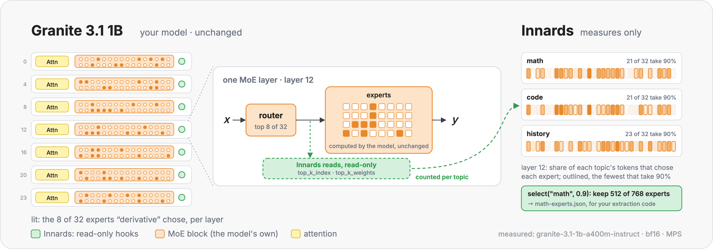

<h1 align="center">Innards</h1>
<h3 align="center">See inside an open-weight model while it runs on your machine: which MoE experts every token and topic activates, and what each architectural feature does</h3>

<p align="center">
  <a href="https://medium.com/@jaiganesan"></a>
  <a href="https://www.linkedin.com/in/jaiganesan-n/"></a>
</p>
<p align="center">
  
  
  
  
  
  
</p>

<p align="center">
  
</p>

Measuring and analysis code for one question: **which experts of a Mixture-of-Experts model does a token, a topic or a task actually use, measured while the model runs and without changing what it computes?** Use it as a package (your code loads the original checkpoint and runs it, for inference or for training) or on its own (`innards view` loads an MoE checkpoint and lets you chat with it); either way Innards attaches read-only hooks to the model and analyzes what they see beside it. For every model, MoE or not, it also records tokens, context, KV cache, memory and timing. Its web view, served from the same machine, lets you chat with the model and see which experts each turn activated in every MoE layer. It targets models that run on a 16 GB machine at 16-bit precision or higher, through Hugging Face Transformers 5.

> [!NOTE]
> **Objective.** I am researching whether the experts that a specialized topic, task or token activates can be taken out of an MoE model and run on their own, as a smaller MoE with the model's own structure, without the full model. That starts with a measurement: which experts every token chose, in every layer, per topic, during inference and training. Innards does that step and exports the expert set a topic needs; building the smaller model is the job of your own code. Innards never removes, merges or edits experts.

| Contents | |
| --- | --- |
| [1. What Innards does](#1-what-innards-does) | The parts, install |
| [2. MoE expert routing](#2-moe-expert-routing) | Trace topics in inference and training, what is measured and derived, any MoE architecture |
| [3. Observe a model](#3-observe-a-model) | One turn per `generate()`: KV, memory, timing, feature analyzers |
| [4. The web view](#4-the-web-view) | Conversation and MoE layers tabs |
| [5. Where results go](#5-where-results-go) | Run folders, schema 1.0 |
| [6. Checks, lineup and KV](#6-checks-lineup-and-kv) | Before loading, pairs of models, KV from a config |
| [Run it](#run-it) | From a clone: setup and tests; repository layout |

---

## 1. What Innards does

| Part | What it gives you |
| --- | --- |
| MoE expert routing | Which experts every token and topic activates, in inference and training, on any MoE architecture (including checkpoints that ship their own code and route inline, the way `facebook/MobileMoE` does), and the experts a topic needs per layer, ready to export |
| Every model | Tokens, context, KV cache per layer (predicted from the config and measured), memory and timing |
| Feature analyzers | One per architectural feature (Gated DeltaNet, gated attention, MoE, mHC, CSA/HCA, DSA, MLA), picked from the model's config |
| Web view | Talk to the traced model and see the experts every turn and topic chose, per MoE layer; served from the machine that runs the model, with no central site and no API key |

Innards loads a model only when you pick one in `innards view`, and runs it only when you send a message from the Conversation tab; its hooks only read. Missing measurements are `null`, never zero, and every value computed from a measurement is labeled as derived.

### Install

<!-- test: install (checked by the fresh-environment wheel install in CI) -->
```bash
pip install innards                  # core: analysis of stored traces, KV calculator, lineage
pip install "innards[hf]"            # + torch, transformers: observe and trace a model
pip install "innards[view]"          # + the web view
pip install "innards[all]"           # everything, including S3 sync and PDF documents

uv add "innards[hf,view]"            # inside a uv project
```

---

## 2. MoE expert routing

### 2.1 Trace topics during inference

`innards.experts.trace` hooks every MoE layer of the model you loaded. Inside `trace.topic(...)`, every forward pass is recorded (the prefill and each decoded token); outside a topic nothing is.

<!-- test: requires=hf,network -->
```python
import torch
from transformers import AutoModelForCausalLM, AutoTokenizer

import innards

model_id = "ibm-granite/granite-3.1-1b-a400m-instruct"  # 32 experts, 8 per token; 2.7 GB in bf16
tokenizer = AutoTokenizer.from_pretrained(model_id)
model = AutoModelForCausalLM.from_pretrained(model_id, dtype=torch.bfloat16)

trace = innards.experts.trace(model, tokenizer, run="topic-experts")  # read-only hooks on every MoE layer
prompts = {
    "math": ["The derivative of x squared is", "Solve for x: 3x + 5 = 20. First,"],
    "code": ["def fibonacci(n):\n    if n <", "import numpy as np\narr = np.zeros("],
}
for topic, texts in prompts.items():
    for text in texts:
        with trace.topic(topic):
            model.generate(**tokenizer(text, return_tensors="pt"), max_new_tokens=16, do_sample=False)

experts = trace.map()  # topic x layer x expert, from the routing the model chose
print(experts.top("math", layer=12, n=4))  # the experts math tokens chose most in layer 12
print(experts.specialists("code", n=3))  # chosen far more for code than for math
keep = experts.select("math", coverage=0.9)  # per layer, the fewest experts that take 90% of math's routing
keep.save("math-experts.json")
print(keep)

routing = trace.tokens()  # every recorded token's experts, per layer
print(routing.token(" x")["counts"][12])  # how often each expert took the token " x" in layer 12
print(routing.expert(layer=12, expert=keep.keep(12)[0])[:3])  # the tokens one expert takes most
trace.close()  # removes the hooks and writes innards_runs/topic-experts/experts/<model>/
```

### 2.2 During training

Give one topic per sequence of the batch. Padding is never counted, and the forward that gradient checkpointing recomputes inside `backward()` is not counted twice. The example fine-tunes only the routers, to stay light; the trace works the same when every weight trains.

<!-- test: requires=hf,network -->
```python
import torch
from transformers import AutoModelForCausalLM, AutoTokenizer

import innards

model_id = "ibm-granite/granite-3.1-1b-a400m-instruct"
tokenizer = AutoTokenizer.from_pretrained(model_id)
model = AutoModelForCausalLM.from_pretrained(model_id, dtype=torch.bfloat16).train()
model.requires_grad_(False)
routers = [m for name, m in model.named_modules() if name.endswith(".router")]
for router in routers:
    router.requires_grad_(True)
optimizer = torch.optim.SGD([p for r in routers for p in r.parameters()], lr=1e-5)

trace = innards.experts.trace(model, tokenizer, run="finetune", tokens=False)  # counts only: light for long runs
batch = tokenizer(
    ["The integral of 2x is x squared.", "for i in range(3):\n    print(i)"], return_tensors="pt", padding=True
)
labels = batch["input_ids"].masked_fill(batch["attention_mask"] == 0, -100)
with trace.topic(["math", "code"]):  # one label per sequence
    loss = model(**batch, labels=labels).loss
loss.backward()
optimizer.step()
print(trace.map())  # <ExpertMap ...: 24 MoE layers; tokens math: ..., code: ...>
trace.close()
```

### 2.3 What is measured, and what is derived

| | Value | Meaning |
| --- | --- | --- |
| Measured | `tokens` | Tokens of a topic that went through each MoE layer (padding excluded) |
| Measured | `counts` | How often each expert was in a token's top-k |
| Measured | per-token routing | Each token's chosen experts and their weights, per layer (`tokens=True`) |
| Derived | `selection` | Share of the topic's tokens whose top-k included the expert (`counts / tokens`) |
| Derived | `gate` | The expert's average share of a token's routing weight |
| Derived | `lift` | Selection for this topic ÷ selection for every other topic together |
| Derived | `select(topic, coverage)` | Per layer, the fewest experts that together take `coverage` of the topic's routing |

`select` saves the expert ids to keep per layer, with the module paths of each layer's router, experts and shared expert and the routing settings from the config. That file is the input for your own code that builds the smaller model; shared experts run for every token and always stay.

### 2.4 Any MoE architecture

Each MoE layer is read from the first place that carries the model's own routing decision:

| Source | Used when |
| --- | --- |
| `experts_input` | The block calls `experts(hidden, top_k_index, top_k_weights)`: transformers 5 MoE models (Qwen3-MoE, Qwen3.5-MoE, Mixtral, OLMoE, Granite MoE, GPT-OSS, DeepSeek-V2/V3, Phi-MoE, LFM2-MoE, Nemotron-H ...) |
| `router_output` | The router module returns the chosen experts |
| `topk` | Code that routes inline, such as `facebook/MobileMoE`: the block's own `torch.topk` |

MoE checkpoints that run with transformers 5.22.1 on a 16 GB machine, checked 2026-11-05: transformers builds each with its own classes, Innards finds its MoE layers, and each passes the before-download checks. `innards view` lists them, after the checkpoints you have already downloaded. It lists only architectures the installed transformers builds natively, so a checkpoint that runs only with its own code is not listed, even when it is downloaded:

| Checkpoint | Architecture | Experts | MoE layers | Weights | Conversation tab | Released |
| --- | --- | --- | --- | --- | --- | --- |
| `ibm-granite/granite-swash-3b-a600m` | `granitemoe_swa` | 48 / top-4 | 28 | 6.0 GB bf16 | text mode | 2026-07-01 |
| `HuggingFaceTB/nanowhale-100m` | `deepseek_v4` | 4 / top-2 | 8 | 0.4 GB fp32 | chat template | 2026-04-24 |
| `utter-project/EuroMoE-2.6B-A0.6B-Instruct-2512` | `mixtral` | 64 / top-8 | 24 | 10.4 GB fp32 | chat template | 2025-12-15 |
| `arcee-ai/Trinity-Nano-Base` | `afmoe` | 128 / top-8 | 54 | 12.2 GB bf16 | chat template | 2025-12-01 |
| `arcee-ai/Trinity-Nano-Preview` | `afmoe` | 128 / top-8 | 54 | 12.2 GB bf16 | chat template | 2025-12-01 |
| `ibm-granite/granite-4.0-h-tiny` | `granitemoehybrid` | 64 / top-6 | 40 | 13.9 GB bf16 | chat template | 2025-09-16 |
| `ibm-granite/granite-4.0-h-tiny-base` | `granitemoehybrid` | 64 / top-6 | 40 | 13.9 GB bf16 | text mode | 2025-09-16 |
| `microsoft/Phi-tiny-MoE-instruct` | `phimoe` | 16 / top-2 | 32 | 7.5 GB bf16 | chat template | 2025-06-23 |
| `utter-project/EuroMoE-2.6B-A0.6B-2512` | `mixtral` | 64 / top-8 | 24 | 5.2 GB bf16 | text mode | 2025-06-09 |
| `ibm-granite/granite-3.1-1b-a400m-base` | `granitemoe` | 32 / top-8 | 24 | 2.7 GB bf16 | text mode | 2024-12-06 |
| `ibm-granite/granite-3.1-1b-a400m-instruct` | `granitemoe` | 32 / top-8 | 24 | 2.7 GB bf16 | chat template | 2024-12-06 |
| `ibm-granite/granite-3.1-3b-a800m-base` | `granitemoe` | 40 / top-8 | 32 | 6.6 GB bf16 | text mode | 2024-12-06 |
| `ibm-granite/granite-3.1-3b-a800m-instruct` | `granitemoe` | 40 / top-8 | 32 | 6.6 GB bf16 | chat template | 2024-12-06 |

These are original releases (no third-party fine-tunes, merges or quantizations). A checkpoint that ships a chat template is talked to through it; one without uses text mode. `allenai/OLMoE-1B-7B-0125-Instruct` (13.8 GB) needs more than 16 GB once the KV cache and headroom are counted. `facebook/MobileMoE` ships code written for transformers 4.57 that stops at its first forward pass on transformers 5. `uv run python scripts/moe_models.py` re-checks the list against the installed transformers, and `--discover` lists new candidates to review.

From the command line, `innards experts` lists every trace under `./innards_runs`, and the **MoE layers** tab of the web view shows a trace live:

<!-- test: cli -->
```bash
innards experts                                   # every trace under ./innards_runs: model, topics, tokens
```

<!-- test: text -->
```text
innards experts innards_runs/topic-experts --topic math                 # top experts per layer
innards experts innards_runs/topic-experts --topic code --by lift       # specialists against the other topics
innards experts innards_runs/topic-experts --topic math --select 0.9 --out math-experts.json
```

---

## 3. Observe a model

`innards.observe` records one turn per `generate()`: tokens, context, KV per layer (predicted vs measured), memory and timing, plus an analyzer for each feature the config says the model has.

<!-- test: requires=hf,network -->
```python
import innards
from transformers import AutoModelForCausalLM, AutoTokenizer

tokenizer = AutoTokenizer.from_pretrained("Qwen/Qwen3.5-0.8B")
model = AutoModelForCausalLM.from_pretrained("Qwen/Qwen3.5-0.8B")  # your code loads the original checkpoint

watch = innards.observe(model, tokenizer, model_id="Qwen/Qwen3.5-0.8B", run="deltanet-study")

messages = [{"role": "user", "content": "Remember this: my name is Priya."}]
inputs = tokenizer.apply_chat_template(messages, add_generation_prompt=True, return_tensors="pt", return_dict=True)
out = model.generate(**inputs, max_new_tokens=32)  # your code, unchanged: one turn

turn = watch.last_turn().record
print(turn.kv.measured_bytes == turn.kv.predicted_bytes)  # True
print(sorted(turn.features))  # ['gated_attention', 'gated_deltanet', 'kv']
watch.close()
```

| Analyzer | Shows |
| --- | --- |
| `kv` (every model) | KV per layer and layer type, growth, context, predicted vs measured |
| `gated_deltanet` | Write strength, retention, half-life, fixed state next to growing KV |
| `gated_attention` | Gate openness per head and token |
| `moe` | Expert load per turn, routing entropy |
| `mhc` | Stream mixing, doubly-stochastic check, signal gain across depth |
| `csa_hca`, `dsa`, `mla` | Compressed and indexer caches, latent vs expanded layout |

`observe` and `innards.experts.trace` can watch the same model at once.

---

## 4. The web view

The view monitors MoE layers only, in two tabs:

| Tab | What it shows |
| --- | --- |
| Conversation | Chat with an MoE model. Each turn runs inside `trace.topic(...)` under the topic you give it, shows the tokens it reused, prefilled and generated, and links to the experts its tokens chose |
| MoE layers | Experts per layer for a topic, topics side by side, the experts each topic needs, specialists, each sequence or conversation turn as tokens × experts; downloads the expert set |

**On its own**, `innards view` loads the MoE checkpoint you pick on the Conversation tab (checkpoints already in your Hugging Face cache are listed first), or the one given with `--model`. It runs the before-download checks first, then loads the original checkpoint at its published precision on CUDA, MPS or CPU:

<!-- test: text -->
```text
innards view                                                     # pick a model on the page: http://127.0.0.1:8000
innards view --model ibm-granite/granite-3.1-1b-a400m-instruct   # load one at start
innards view --trust-remote-code                                 # also models that ship their own code
innards view ./innards_runs/topic-experts                        # one run folder, e.g. copied from another machine
ssh -L 8000:127.0.0.1:8000 user@<gpu-host>                       # a remote machine's view through a tunnel
```

**As a package**, your code loads the model and serves the same page with `trace.view(chat=True)`; the Conversation tab talks to that model:

<!-- test: text -->
```text
trace = innards.experts.trace(model, tokenizer, run="chat")       # the model and tokenizer your code loaded
server = trace.view(chat={"max_new_tokens": 256}, topic="chat")   # generate() arguments; returns at once
server.wait()                                                     # serve until Ctrl-C, then trace.close()
```

Architectures your transformers knows load with its own classes. A checkpoint that ships its own code for an architecture transformers doesn't have yet (`facebook/MobileMoE`, `Tiiny/SmallThinker`) is not listed; type its id, and it loads only when you start the view with `--trust-remote-code`. Read that code first: it runs on your machine. Even then, a checkpoint whose architecture transformers knows natively never runs its own code. Such a model is built by its own code on real tensors, and then every weight is copied from the checkpoint; `from_pretrained` in transformers 5 builds on the meta device, which code written for a checkpoint often can't run on. A tensor the checkpoint lacks stops the load. Code written for an older transformers can still fail: `facebook/MobileMoE`'s published code targets transformers 4.57.6 and stops at its first forward pass on transformers 5. Innards runs a checkpoint's code as published and does not patch it. From your own code, `innards.view.loader.load_with_own_code(model_id, device=...)` loads such a checkpoint the same way.

Either way, the page calls `generate()` only when you send a message, with the model's generation config. An instruct checkpoint is talked to through its chat template. A base checkpoint has none, so the tab switches to text mode: your first message is the start of a text, each later message is added to the text so far exactly as you typed it, and the model continues it. No template is invented. When the cache holds only attention keys and values, the next turn reuses it, so every token goes through the MoE layers once and the conversation is one sequence of the trace. Recurrent or convolution state (Mamba, DeltaNet, conv layers) is never carried over: those turns are prefilled from the start, and the page shows 0 tokens reused. As a package, don't run the model from your own code while the page is generating.

---

## 5. Where results go

Results stay on the machine that runs the model:

<!-- test: text -->
```text
innards_runs/<run>/run.json                                 name, host, environment
innards_runs/<run>/<conversation>/turns.jsonl               one TurnRecord (schema 1.0) per turn
innards_runs/<run>/experts/<name>/summary.json              expert trace: topics, tokens and counts per layer
innards_runs/<run>/experts/<name>/tokens/shard-*.safetensors   per-token experts, weights, positions, topics
innards_runs/<run>/experts/<name>/conversations.jsonl   the Conversation tab: each turn's topic, text, tokens, sequence
```

<!-- test: check-output -->
```python
from innards.schema import TurnRecord

record = TurnRecord.from_dict(
    {
        "schema_version": "1.0",
        "run": "deltanet-study",
        "conversation": "20261103-081500-Qwen3.5-0.8B-a1b2",
        "turn": 7,
        "timestamp": "2026-11-03T08:15:42Z",
        "model": {"id": "Qwen/Qwen3.5-0.8B", "architecture": "hybrid", "features": ["gated_deltanet"]},
        "runtime": {"backend": "observe"},
        "kv": {"predicted_bytes": 2154496, "measured_bytes": 2154496, "measured_source": "hf_cache"},
    }
)
print(record.kv.measured_bytes, record.memory.peak_bytes)  # 2154496 None
```

---

## 6. Checks, lineup and KV

Before anything is downloaded, `validate` checks architecture support, the device against the checkpoint's published precision, and whether weights plus KV fit the memory budget (16 GB by default, `INNARDS_GPU_BUDGET_GB`):

<!-- test: check-output requires=hf -->
```python
from innards.validate import validate

report = validate("ibm-granite/granite-swash-3b-a600m", device="mps", check_access=False)
print(report.status)  # Ready
small = validate("ibm-granite/granite-swash-3b-a600m", device="mps", budget_gb=4, check_access=False)
print([check.id for check in small.blocked])  # ['memory']
```

The lineup pairs a newer model with the version before it, each running on a 16 GB machine at 16-bit precision:

| Feature | Newer model | Version before |
| --- | --- | --- |
| Gated DeltaNet + gated attention | Qwen3.5-0.8B (or 2B) | Qwen3-0.6B (or 1.7B) |
| MoE with a shared expert + sliding-window attention | Granite Swash 3B-A600M | Granite 3.1 3B-A800M |

`predict` gives KV bytes and a per-layer breakdown from a config alone, and `explain` says what an architecture changed from its predecessor:

<!-- test: check-output -->
```python
from innards.kv import predict
from innards.lineage import explain
from innards.lineage.lineup import model_config

p = predict(model_config("ibm-granite/granite-swash-3b-a600m"), context_tokens=32768, kv_dtype="bf16")
print(p.architecture, round(p.total_bytes / 2**20))  # sliding_window 258
print(explain("gqa").predecessor, "->", explain("gqa").family)  # mha -> gqa
```

<!-- test: cli -->
```bash
innards lineup                                               # the pairs and what each newer model adds
innards predict --model Qwen/Qwen3-0.6B --context 32768 --kv-dtype fp8
innards explain sliding_window
innards validate Qwen/Qwen3.5-0.8B --device cpu --set with_context
```

---

## Run it

From a clone, with [uv](https://docs.astral.sh/uv/):

<!-- test: dev -->
```bash
git clone https://github.com/jaiganesan-n/innards.git && cd innards
uv sync --all-extras                                    # Python 3.13, torch, transformers 5, FastAPI, dev tools
uv run pytest                                           # unit tests, README examples, small real checkpoints
uv run ruff check && uv run ruff format --check && uv run mypy src
INNARDS_REMOTE_CODE_TESTS=1 uv run pytest tests/test_experts_models.py -k mobilemoe   # MobileMoE's own code: xfail on transformers 5
uv run --with playwright python docs/figures/src/make_banner.py --measure           # re-trace Granite, redraw the banner
```

### Repository layout

<!-- test: text -->
```text
innards/
├── README.md, LICENSE
├── pyproject.toml, uv.lock, .python-version   # uv; Python 3.10 to 3.15
├── src/innards/
│   ├── experts/     routing.py, trace.py, analysis.py     # MoE expert routing
│   ├── observer/    watch.py, probes.py, observer.py, cache.py
│   ├── features/    one analyzer per architectural feature
│   ├── kv/          KV calculator
│   ├── lineage/     lineup, pinned configs, architecture families
│   ├── view/        web view: Conversation and MoE layers tabs (FastAPI, static page)
│   ├── schema.py, store.py, sync.py, validate.py, sets.py
│   └── cli.py       # innards <command>
├── tests/           replicas.py (tiny random-weight models), test_*.py
├── scripts/         overhead_bench.py, moe_models.py (re-checks the models innards view offers)
├── docs/figures/    banner_light.png, banner_data.json (what the banner shows), src/make_banner.py
└── .github/workflows/  ci.yml, publish.yml (PyPI on a v* tag)
```

## License

Code: Apache 2.0 (`LICENSE`). Models keep their own terms: Innards downloads weights only when you load a model in `innards view`, through transformers (`facebook/MobileMoE` is gated, for non-commercial research only).

---

## Author

**Jai Ganesan** · [Medium](https://medium.com/@jaiganesan) · [LinkedIn](https://www.linkedin.com/in/jaiganesan-n/)

> [!IMPORTANT]
> **Note.** Innards is developed on one MacBook Air M5 with 16 GB of memory, so it targets models that fit there. If you trace another MoE model, or one whose routing Innards does not read yet, let me know.
